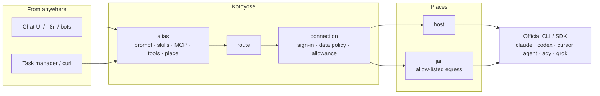

# Kotoyose

**One word summons the AI you already use.**

[](LICENSE)
[](pyproject.toml)

[日本語](README.md)

Kotoyose is a self-hosted server that brings official AI CLIs and SDKs such as Claude Code and OpenAI Codex together. You bundle a system prompt, skills, MCP servers, allowed tools and a place to run into one `alias`, then call it through an OpenAI-compatible API or a task execution API. Your subscriptions' allowances are tracked and shared out, and the same working environment is available to any chat UI or automation tool.

## Why

The way we use AI today scatters configuration across every caller: a chat UI, n8n, a Discord bot, a task manager. The same prompts and MCP servers get copied into each tool, and keeping them in sync never quite happens.

Going the other way and loading every skill and MCP server into one environment puts descriptions of unrelated tools into the context, so every call spends tokens it does not need.

On top of that, subscriptions mostly work only inside each vendor's own app, and many tools that reach them from outside pull out the login token and call private endpoints, which risks the terms of service and the account. Kotoyose keeps the definition of each working environment in one place on the server, and lets you reach the official CLI or SDK from outside while still using it the official way.

## What you get

- **Define the environment once, use the same AI everywhere.** Bundle a system prompt (prompt files), skills, MCP servers, the other aliases it may delegate to, allowed tools (`tools` / `deny`) and the place to run (`host` / `isolated`) under an `alias`. Whether the call comes from a chat UI, n8n, a Discord bot, your own task manager or curl, the same name gives you the same environment. Prompts, skills and MCP servers are registered once and shared by many aliases.
- **Hand work to another model.** Kotoyose is itself an MCP server (`list_agents` / `ask_agent`), so an agent can delegate a task to another alias, for example sending a research step from Claude to Grok. A delegated agent cannot delegate further. Jailed coding agents can delegate to aliases that open the same workspace read-only.
- **Use it from T3 Code or Zed.** `kotoyose-acp` speaks ACP and lists your aliases as models. It streams text and tool progress, and keeps the conversation when you switch models.
- **Only what the job needs, so fewer tokens.** Skills and MCP servers are chosen per alias. Only the pieces that use case needs reach the context, so you do not pay for descriptions of unrelated tools.
- **Make the most of the subscriptions you pay for.** Kotoyose runs each vendor's official CLI or SDK, so work is billed to your subscription allowance rather than separate API pricing. Remaining 5-hour and weekly allowances come from the official surfaces and show up on the dashboard. A `combo` groups several aliases: it skips a candidate whose allowance is used up until it resets, or spreads load across subscriptions.
- **No token extraction.** Sign in from the console with each vendor's own flow (paste a code, browser, device code). The CLI keeps its own credentials in an Kotoyose-dedicated directory; Kotoyose never reads or forwards them.
- **Agents stay in a jail.** Coding agents run inside a jail (bubblewrap or a container) that can only reach allow-listed hosts. Output that would leak a credential is stopped before it leaves.
- **Training routes need explicit consent.** Every connection declares whether its input is used for training. On routes that are, or might be, MCP servers and tools are off by default and must be acknowledged per alias.
- **OpenAI-compatible API and a task execution API.** `POST /v1/chat/completions` supports streaming and image input and works unchanged from Open WebUI, n8n, the OpenAI SDK or curl. With `POST /v1/executions`, an external task manager can run a coding agent in the jail and get the diff back, with time limits, waiting for allowances to recover, cancellation and resume.
- **An admin console and access control.** Manage connections and sign-ins, check allowances, edit aliases, routes, prompts, skills and MCP servers, issue API keys and browse execution records. CLIs can be installed from the console too: versions are pinned, downloads are integrity-checked, and package scripts never run. A `client` and its API keys decide who may use which alias, and where.

## An alias, for example

Register the pieces once, then give each use case only what it needs. Clients just name the alias, and get the same environment wherever they call from.

```yaml
models:
  assistant-chat:                 # clients only ask for this name
    route: claude-opus-subscription
    prompt_file_refs: [identity, principles]
    skill_refs: [summarize]
    mcp_refs: [memory, websearch]
  orchestrator-coding:                 # the same pieces build a different environment
    route: codex-gpt-subscription
    prompt_file_refs: [code-comment-rule]
    agent: { place: isolated, surface: write }
```

Here the conversational `assistant-chat` carries only a summarizing skill and search-style MCP servers, while the coding `orchestrator-coding` gets a different route and an isolated place. They share pieces without loading tools they do not use, which keeps the context small.

## How it works



- `connection`: which official CLI or SDK account to use, whether its input is used for training, and its remaining allowance.
- `route`: which driver, model and connection to run with.
- `alias`: a named working environment that bundles a `route` with prompt files, skills, MCP servers, the aliases it may delegate to (`delegates`), `tools` / `deny`, the place to run (`host` / `isolated`) and training consent. A `combo` can group several aliases and send work to whichever has room.
- `client`: decides, per API key, who may use which `alias`, and where.

## Supported AI

| AI | Sign-in | chat (host) | coding (jail) | allowance |
| --- | --- | :---: | :---: | :---: |
| Claude (Claude Code / Agent SDK) | CLI login, setup token, API key, Anthropic-compatible endpoint | ✓ | ✓ | ✓ |
| OpenAI Codex | ChatGPT login, API key, custom model provider | ✓ | ✓ | ✓ |
| Cursor | CLI login, SDK API key | ✓ | ✓ (CLI) | — |
| Google Antigravity | CLI login, SDK API key / Vertex | ✓ | ✓ (CLI) | ✓ |
| xAI Grok Build | CLI login | ✓ | ✓ | ✓ |

What actually works depends on your plan, your OS and the CLI version you install.

Claude Code and Codex use the binaries bundled with their SDKs. You can install the Linux x86_64 builds of Cursor, Antigravity, and Grok Build from the console’s Providers page.

## Important

- You are responsible for complying with each AI service's terms of service.
- The Kotoyose repository does not bundle any vendor CLI or binary.
- Kotoyose is not affiliated with any vendor listed above.
- Company, product and service names are trademarks or registered trademarks of their owners.

## Getting started

You need Linux, Python 3.11+ and [`uv`](https://docs.astral.sh/uv/). Persistent API keys and the task execution API need PostgreSQL; the jail needs `bwrap` and Linux namespaces (or Docker for container workers).

```sh
git clone https://github.com/waigoma/kotoyose.git kotoyose
cd kotoyose
uv sync
cp .env.example .env
cp config.example.yml config.yml
mkdir -p ~/kotoyose-workspace
```

Set the admin password `KOTOYOSE_TOKEN` in `.env`, then start the server.

```sh
uv run uvicorn kotoyose.app:app --host localhost --port 8000
```

Sign in to [the console](http://localhost:8000/admin/ui) with `KOTOYOSE_BASIC_USER` (default `kotoyose-service`) and `KOTOYOSE_TOKEN`. Create a connection under **Providers** and sign in with the vendor's flow, create the name to call under **Routes** and **Aliases**, then issue an API key under **Endpoint**:

```sh
curl http://localhost:8000/v1/chat/completions \
  -H "Authorization: Bearer <CLIENT_API_KEY>" \
  -H 'Content-Type: application/json' \
  -d '{"model":"<ALIAS>","messages":[{"role":"user","content":"Hello!"}]}'
```

To keep API keys across restarts, set the PostgreSQL settings (`POSTGRES_URL` and friends). For everything else, see [`config.example.yml`](config.example.yml) and [`execution.example.json`](execution.example.json).

## API

| endpoint | purpose |
| --- | --- |
| `POST /v1/chat/completions` | OpenAI-compatible chat, with streaming and image input |
| `GET /v1/models` | Aliases available to the API key |
| `POST /v1/executions` | Task execution API (when configured) |
| `GET /health`, `GET /ready` | Liveness and task-execution readiness |
| `GET /admin/ui` | Admin console |

Every API is documented as OpenAPI at [`/docs`](http://localhost:8000/docs) on the running server.

See the [documentation index](docs/README.md) for usage guides and API contracts.
[Guide to adding a provider (Japanese)](docs/adding-a-provider.md)

## Contributing

Issues and pull requests are welcome. Before sending one, run:

```sh
uv sync --extra dev
uv run ruff check src tests
uv run pytest -q
```

Please report vulnerabilities through GitHub's private vulnerability reporting, not as issues. See [SECURITY.md](SECURITY.md).

## License

[Apache License 2.0](LICENSE)
