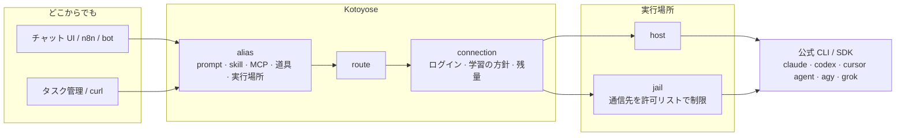

# Kotoyose

**ことばひとつで、いつもの AI を呼び寄せる。**

[](LICENSE)
[](pyproject.toml)

[English](README.en.md)

Kotoyose の名前は「言 (こと)」と「口寄せ」に由来します。

Kotoyose は、Claude Code や OpenAI Codex などの公式 CLI / SDK を束ねるセルフホストのサーバーです。system prompt、skill、MCP サーバー、使ってよい道具、実行場所を一つの `alias` に定義し、OpenAI 互換 API やタスク実行 API から呼び出せます。各社のサブスクリプション枠を残量を見ながら使い分けられ、外部のチャット UI や自動化ツールから同じ作業環境をそのまま利用できます。

## なぜ作ったのか

普段 AI を使うとき、チャット UI、n8n、Discord の bot、タスク管理ツールなど、呼び出し元のツールごとに設定がばらばらになりがちです。プロンプトや MCP サーバーを各ツールへ何度も書き写す手間がかかり、設定の更新も追いつきません。

一方で、あらゆる skill や MCP サーバーを詰め込んだ環境を作ると、用途に無関係な道具の説明まで context に載ります。その結果、毎回余分なトークンを消費してしまいます。

さらに、契約しているサブスクリプションは専用アプリの中でしか使えないことが多く、外から呼べる非公式な道具の多くは認証トークンを抜き取って通信するため、規約違反やアカウント停止の危険があります。Kotoyose は、作業環境の定義をサーバー側に一か所で持ち、公式の CLI / SDK を安全な手順のまま外部から呼べるようにするために作りました。

## できること

- **AI の作業環境を一度定義すれば、どこからでも同じ AI が使える**: system prompt (prompt ファイル)、skill、MCP サーバー、頼んでよい別の alias、使ってよい道具 (`tools` / `deny`)、実行場所 (`host` / `isolated`) を `alias` という名前に束ねて定義できます。チャット UI、n8n、Discord の bot、自作のタスク管理、curl のどこから呼んでも、同じ名前を指定すれば同じ環境の AI が出てきます。prompt・skill・MCP などの部品は一か所に登録し、複数の `alias` から参照して使い回せます。
- **別の model に作業を頼める**: Kotoyose 自身が MCP サーバー (`list_agents` / `ask_agent`) を持ち、agent は別の `alias` に作業を頼めます。Claude の作業の途中で調べものを Grok に回す、といった使い方ができます。頼まれた側はさらに別の alias に頼めません。jail で動くコーディングの agent からも、同じ作業場を読み取り専用で開く alias に頼めます。
- **T3 Code や Zed から使える**: `kotoyose-acp` は ACP のエージェントとして動き、`alias` を model の選択肢として並べます。本文と道具の進捗を流し、途中で model を切り替えても会話を引き継ぎます。
- **用途ごとに必要なものだけを持たせるので、トークン効率が良い**: skill や MCP サーバーは `alias` ごとに定義します。その用途に要る部品だけが context に載るため、全部入りの環境に比べて無関係な道具の説明でトークンを消費しません。
- **契約しているサブスクの枠を、うまく使い切れる**: 各社の公式 CLI / SDK をそのまま動かすため、API の別料金ではなくサブスクリプションの枠で動作します。残量 (5 時間枠・週の枠) は公式の口から取得してダッシュボードに表示します。複数の `alias` を束ねる `combo` を使うと、枠を使い切った候補をリセットまで飛ばして次を使ったり、複数のサブスクに負荷を散らしたりできます。
- **トークンを抜かない**: ログインはコードの貼り付け、ブラウザ、デバイスコードといった各社の公式の手順で管理コンソールから行います。トークンは CLI 自身が Kotoyose 専用のディレクトリで保持し、Kotoyose は読み取りも転送もしません。
- **エージェントを閉じ込める**: コーディングエージェントは jail (bubblewrap やコンテナ) の中で動き、許可した宛先にしか通信できません。出力に認証情報が混ざった場合は、外に出る前に止めます。
- **学習に使われる経路は明示の承諾が要る**: 接続ごとに「入力が学習に使われるか」を宣言します。学習に使われる経路や不明な経路では MCP サーバーや道具などは既定で使えず、`alias` ごとに承諾して初めて使えるようになります。
- **OpenAI 互換 API とタスク実行 API を備える**: `POST /v1/chat/completions` はストリーミングと画像入力に対応し、Open WebUI、n8n、OpenAI SDK、curl からそのまま呼べます。`POST /v1/executions` を使うと、外部のタスク管理からコーディングエージェントを jail で走らせて差分を受け取れ、上限時間、利用枠の回復待ち、中止、再開にも対応します。
- **管理コンソールとアクセス制御が揃っている**: コンソールから接続とログイン、残量の確認、`alias`・`route`・prompt・skill・MCP の編集、API キーの発行、実行の記録を行えます。CLI の導入もコンソールから版を固定し、配布物の整合性を照合してから行い、配布物の script は実行しません。`client` と API キーの組み合わせで「誰が、どの `alias` を、どこで使ってよいか」を決められます。

## alias の例

部品を一か所に登録しておき、用途ごとに必要なものだけを `alias` に束ねます。クライアントからはその `alias` の名前を指定するだけで、どこから呼んでも同じ環境が使えます。

```yaml
models:
  assistant-chat:                 # クライアントはこの名前を指定するだけ
    route: claude-opus-subscription
    prompt_file_refs: [identity, principles]
    skill_refs: [summarize]
    mcp_refs: [memory, websearch]
  orchestrator-coding:                 # 同じ部品から、別の用途の環境も作れる
    route: codex-gpt-subscription
    prompt_file_refs: [code-comment-rule]
    agent: { place: isolated, surface: write }
```

上の例では、対話用の `assistant-chat` には要約 skill や検索系 MCP だけを持たせ、コーディング用の `orchestrator-coding` には別の `route` と隔離環境を割り当てています。同じ部品を共有しながら不要な道具を載せないため、context の消費を抑えられます。

## しくみ



- `connection`: 各社の公式 CLI / SDK のログイン先、入力が学習に使われるかの方針、利用枠の残量を管理する接続です。
- `route`: どの driver、model、connection で動かすかを決める経路です。
- `alias`: `route` に prompt ファイル、skill、MCP サーバー、頼んでよい別の alias (`delegates`)、`tools` / `deny`、実行場所 (`host` / `isolated`)、学習の承諾を束ねた作業環境の名前です。`combo` で複数の `alias` を束ね、空いている方へ振り分けることもできます。
- `client`: 発行した API キーごとに、誰が、どの `alias` を、どこで使ってよいかを制御する単位です。

## 対応している AI

| AI | 認証の方法 | chat (host) | coding (jail) | 残量 |
| --- | --- | :---: | :---: | :---: |
| Claude (Claude Code / Agent SDK) | CLI ログイン、setup token、API キー、Anthropic 互換 endpoint | ✓ | ✓ | ✓ |
| OpenAI Codex | ChatGPT ログイン、API キー、独自の model provider | ✓ | ✓ | ✓ |
| Cursor | CLI ログイン、SDK の API キー | ✓ | ✓ (CLI) | — |
| Google Antigravity | CLI ログイン、SDK の API キー / Vertex | ✓ | ✓ (CLI) | ✓ |
| xAI Grok Build | CLI ログイン | ✓ | ✓ | ✓ |

実際に使えるかは、契約しているプラン、OS、導入した CLI の版によります。

Claude Code と Codex は SDK に CLI が同梱されているため、個別の導入は不要です。コンソールの Providers から Cursor、Antigravity、Grok Build の Linux x86_64 版を導入できます。

## 大事な注意

- 各 AI サービスの利用規約を守る責任は利用者にあります。
- Kotoyose のリポジトリには、各社の公式 CLI やバイナリを同梱していません。
- Kotoyose は表に記載した各社と提携していません。
- 記載している会社名、製品名、サービス名は各社の商標または登録商標です。

## はじめる

必要なもの: Linux、Python 3.11 以上、[`uv`](https://docs.astral.sh/uv/)。API キーの保存とタスク実行 API には PostgreSQL、jail には `bwrap` と Linux の名前空間 (またはコンテナ用の Docker) が要ります。

```sh
git clone https://github.com/waigoma/kotoyose.git kotoyose
cd kotoyose
uv sync
cp .env.example .env
cp config.example.yml config.yml
mkdir -p ~/kotoyose-workspace
```

`.env` に管理用のパスワード `KOTOYOSE_TOKEN` を設定してから起動します。

```sh
uv run uvicorn kotoyose.app:app --host localhost --port 8000
```

[コンソール](http://localhost:8000/admin/ui) に `KOTOYOSE_BASIC_USER` (既定は `kotoyose-service`) と `KOTOYOSE_TOKEN` でログインします。**Providers** で接続を作って公式の手順でログインし、**Routes** と **Aliases** で呼び出す名前を作ります。**Endpoint** で API キーを発行すれば、すぐに呼べます。

```sh
curl http://localhost:8000/v1/chat/completions \
  -H "Authorization: Bearer <CLIENT_API_KEY>" \
  -H 'Content-Type: application/json' \
  -d '{"model":"<ALIAS>","messages":[{"role":"user","content":"こんにちは"}]}'
```

API キーを再起動後も残すには PostgreSQL の接続設定 (`POSTGRES_URL` など) を、細かな設定は [`config.example.yml`](config.example.yml) と [`execution.example.json`](execution.example.json) を参照してください。

## API

| endpoint | 用途 |
| --- | --- |
| `POST /v1/chat/completions` | OpenAI 互換の chat。ストリーミングと画像入力に対応 |
| `GET /v1/models` | その API キーで使える alias の一覧 |
| `POST /v1/executions` | タスク実行 API (設定したときだけ) |
| `GET /health`、`GET /ready` | 稼働の確認と、タスク実行の受付の可否 |
| `GET /admin/ui` | 管理コンソール |

起動中のサーバーの [`/docs`](http://localhost:8000/docs) で、すべての API を OpenAPI として確かめられます。

詳しい使い方と API 契約は [文書一覧](docs/README.md) を参照してください。
[provider の追加手順](docs/adding-a-provider.md)

## 開発に参加する

Issue と Pull Request を歓迎します。送る前に、次を流してください。

```sh
uv sync --extra dev
uv run ruff check src tests
uv run pytest -q
```

脆弱性は Issue ではなく、GitHub の非公開の報告機能で知らせてください。詳しくは [SECURITY.md](SECURITY.md) にあります。

## ライセンス

[Apache License 2.0](LICENSE)
