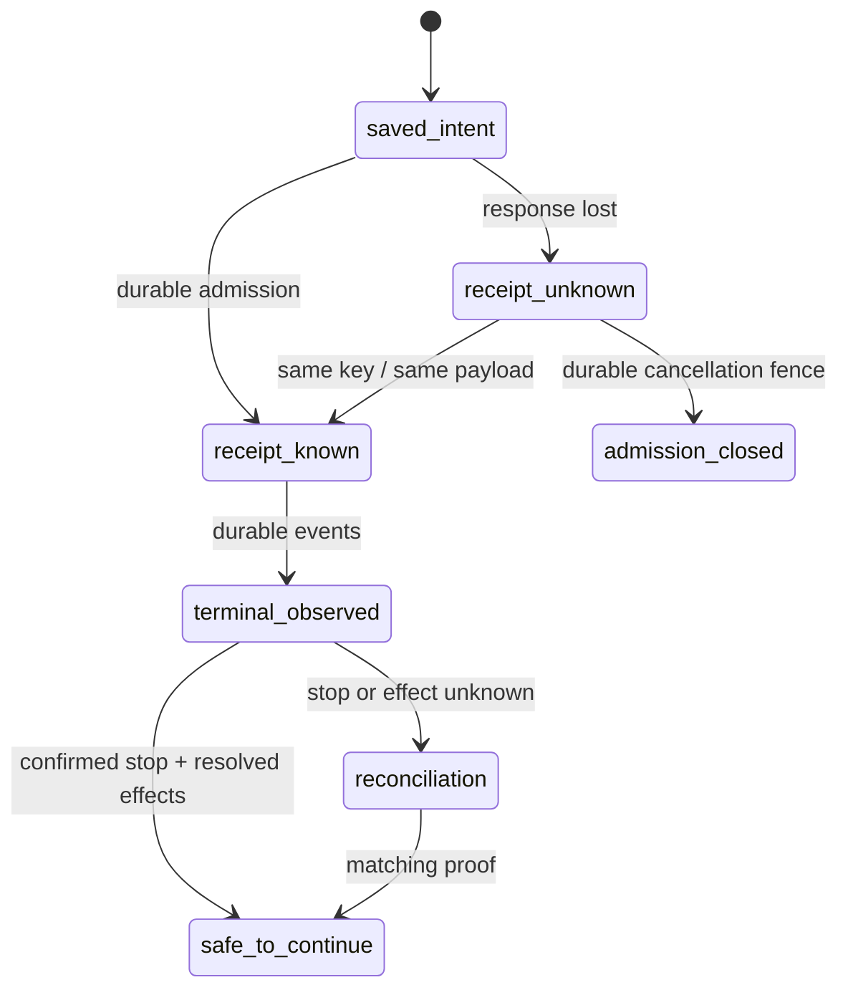

# Agent Development Standard v1

本標準は、Caller の意図・policy と Kotoyose の実行機構を分離するための契約である。
実装への適用状況は [conformance checklist](conformance-v1.md) に記録する。
仕様全体の完了や、未試験の provider / Worker の適合を宣言する文書ではない。

## 1. 責務と完了

Caller は依頼、役割、実行順序、受入条件、完了目標、承認、予算を所有する。
Kotoyose は認証された Caller の範囲内で、実行、隔離、停止、resource 解決、events と artifact bytes を所有する。
orchestrator の Task / PR を Kotoyose の状態へ持ち込まない。

| 概念 | 正本 | 完了が意味すること |
| --- | --- | --- |
| Task / workflow | Caller | 起票時に固定した目標へ到達した |
| Run | Caller | 一つの役割の実行と出力契約が完了した |
| Attempt | Kotoyose | 固定した実行要求が終端へ到達した |
| Session | provider adapter | 会話の継続単位。workflow の正本には使わない |
| Verification | orchestrator 等の Caller | 固定候補について、必須条件と evidence が揃った |
| Operation | 副作用を実行する broker | 固定 intent の外部結果を照合した |

Attempt の terminal status と、`stop_confirmation=confirmed`、`side_effect_resolution=resolved` は別々に確認する。
停止や外部結果が不明な場合、同じ可変 workspace を次の実行へ渡さない。
Agent の成功宣言だけで Run、Verification、Task を完了させない。

非 coding Role は、PM Session、Butler Session、Memo、Task などの Caller 所有元を Run の正本として固定する。
Role Run には所有元、request key、Definition と execution template の不変 snapshot を保存し、同じ key に異なる入力、設定、completion を重ねない。
初回に決めた期限、workspace、予約 ref、会話入力を再読時に再生成しない。
会話 Role は ledger を正本として各 turn を fresh Attempt に入力し、provider session resume や互換 chat の conversation key を会話文脈の代用に使わない。

- orchestrator の `apps/api/src/services/role-invocations.ts` (Role invocation) と `apps/api/src/services/role-execution-controller.ts` (Role execution controller) が、所有元、request key、初回 workspace / reservation と fresh Attempt を固定する実装例である。

## 2. 認証と Grant

Caller principal は接続の認証から決める。
request body の principal、`trusted`、`allow` を権限上限の根拠にしない。
実効権限は Caller の上限、固定 Grant、選択した Worker / provider が実施できる制限の共通範囲とする。

Grant は Run、workspace、resource、profile、隔離、有効期間、予算、委任の版へ束縛する。
既存の ID / version を別の内容で上書きしない。
重要な操作の直前にも失効と対象を照合する。
必要な制限を実施できない能力は開始前に拒否する。

通常の command は sandbox を使う。
native は Caller の明示指定、管理者設定、Grant、request の一致が必要である。
native でも credential 分離、対象制約、取消と停止証拠を維持する。

## 3. dispatch と復旧

Caller は送信前に入力 snapshot、idempotency key、Run と dispatch の対応を保存する。
同じ key で payload を変えない。
受理証が消失しても key を作り直さず、同じ要求の照合へ進む。
通信ライブラリの一般的な POST retry を、新しい実行の作成に流用しない。



取消時に Attempt ID が不明なら、`POST /v1/execution-cancellations` で admission を閉じる。
`not_admitted` は新しい受理を防ぐ永続的な証拠である。
`attempt_known` は既存 ID を返すだけであり、実停止の証拠にはしない。
Worker 切替、model 変更、semantic retry、Repair は Caller が判断する。

events は Attempt と sequence で重複排除する。
同じ sequence の異なる payload、欠落、別 Attempt の結果を検出し、古い結果で新しい状態を上書きしない。
再接続で events を読むことと、新しい Attempt を dispatch することを区別する。

## 4. 入力、Memory、圧縮

入力は content ref と provenance を保持する。
Repository Context Pack、Handoff、Memory は、作成した container の信頼度で本文を昇格させない。
Agent が書いた記憶や外部情報を system instruction にしない。

Pack / Skill の pin には content / schema digest、source commit、generator / version、config digest、repository identity、依存 closure を含める。
tag は取得時に commit へ解決する。
必須 ref の欠落、不整合、失効を黙って無視しない。
ambient な user / repository config や plugin から tool 面を追加しない。

Memory Platform を記憶の正本とし、Caller が project / role / user の namespace と読書き範囲を決める。
user namespace を複数 Caller で無条件に共有しない。
固定 snapshot の再利用時も削除、失効、権限取消を再評価する。

圧縮 mode は事前に許可した `runtime_managed` と `caller_controlled` を区別する。
制御・観測できない能力を対応済みと申告しない。
同じ Session の圧縮を fresh Run への Handoff と混同しない。

## 5. Tool、副作用、承認

Tool の実行場所にかかわらず、認証、対象制約、版、timeout、重複時の意味を定める。
MCP annotation や tool 自身の申告だけで read-only と認定しない。
client tool は principal、Attempt、接続世代に束縛する。
切断後の結果不明を、未実行と同じ扱いにしない。

client tool の `arguments_digest` は、引数を JSON 型だけへ再帰的に正規化した正準 JSON の UTF-8 bytes に対する SHA-256 hex とする。
object key は文字列だけを許可して code point 順に整列し、bool、null、文字列、list は値を維持する。
int は絶対値 `2**53` 以下、float は有限値だけを許可し、その範囲の整数値 float は int にそろえる。
正準 JSON は `sort_keys=True`、区切り文字 `(',', ':')`、`ensure_ascii=False`、`allow_nan=False` の表現を使い、lone surrogate と非 JSON 型を拒否する。
正準化の実装は [client_tool_digest.py](../../src/kotoyose/client_tool_digest.py) とし、Caller と Kotoyose は [共有 vector](../../tests/fixtures/client_tool_arguments_digest_vectors.json) の canonical text と digest に一致しなければならない。

Caller は client call の handler を配送する前に、stable Operation intent を durable に保存する。
保存済み Operation が `in_flight` のまま Caller が落ちた場合、handler を再実行しない。
送信結果の消失、timeout、handler error で effect が `read` 以外の Call は `unknown` として保持し、再配送や再実行で解決しない。
`read` はその Tool の無副作用契約で `not_applied` を証明できる場合だけその結果を記録する。
`unknown` は認証済み Caller の遅延結果または read-only 照合でのみ解決する。

- orchestrator の `apps/api/src/services/role-tool-bridge.ts` (Role Tool bridge) が、送信前 Operation、`in_flight` の非再実行、non-`read` の `unknown` を実装する例である。

副作用の前に stable Operation intent を保存する。
応答消失時は read-only の照合を優先し、観測不足だけで再実行しない。
set、append、play 等は重複時の意味が異なるため、handler ごとに照合契約を持つ。

Approval は対象の digest、根拠、判断者、有効期間、取消、消費先を保存する。
検証条件の緩和と権限拡張は人の明示承認を必要とする。
merge 承認を検証条件変更の承認に読み替えない。
消費先の Operation に同じ承認対象 digest が保存されていることを照合する。

## 6. 予算と親子 Run

未知の費用を 0 として扱わない。
reported / estimated / unknown、予約と精算、時間・資源上限と厳密な金額上限を区別する。
停止や費用が不明な予約を、次の実行を通すために解放しない。
provider の金額保証が必要なら、その保証に対応した backend だけを選ぶ。

Role ごとに runtime-native または Platform Child Run を事前指定する。
子の権限は委任上限内とし、親の cancel / revoke と累積予算へ接続する。
親が待機しても子を開始できる admission を設計し、実資源の消費を隠さない。
保証できない runtime-native 実行は拒否し、事前承認のない別 model へ切り替えない。

Role の予約上限不足または共有 cap の版競合は、Kotoyose へ dispatch する前に `awaiting_approval` として待機する。
人が増額対象と変更後の上限を承認した場合、Caller は保存済みの再開 intent を `queued` に戻し、同じ初回 dispatch key、Grant identity / version、reservation ref で送信する。
この経路は dispatch が未保存の Role Run に限る。
送信済み Attempt の予算超過は、停止確認と副作用解決後であっても、この Role 再開経路で新しい Attempt へ置き換えない。

- orchestrator の `apps/api/src/services/role-execution-controller.ts` (Role execution controller) と `docs/agent-platform-v2-budget-increase.md` (Role budget increase) が、送信前待機と同一 dispatch identity の再開を実装する例である。

## 7. Artifact と Coding への追加条件

ArtifactStore は bytes、digest、保存完了を管理する。
Caller は証拠としての意味、公開範囲、保持期間を管理する。
外部公開した bytes の保存を確認するまで元 artifact を GC しない。
公開 URL の到達確認と、認証付きの内部 artifact 取得を区別する。

Coding の検証は固定 Candidate の独立コピーで行う。
Candidate、Profile、Scope、environment の 4 digest と stage の evidence を対応させる。
必須 stage の欠落、ERROR、SKIPPED、画像不足、形式不正を PASS にしない。
Repair は fresh Run とし、元 Run と結果を保存する。
Judge 不在や修正上限だけで必須指摘を advisory へ降格しない。

checkpoint の回復範囲は `selected_files` であり、Git control state、Session、symlink、ACL、未選択ファイル、checkpoint 以後の変更を含む repository clone の回復ではない。
Coding の fresh Run に checkpoint を使う場合は、repository identity を別途固定して検証する。
選択ファイルの復元だけから、元 workspace の最新状態または repository の完全な復元を主張しない。

- orchestrator の `docs/agent-platform-v2-checkpoints.md` (checkpoint contract) と `apps/api/src/services/runtime-lifecycle.ts` (Runtime lifecycle) が、Caller が回復範囲を所有し、Kotoyose の workspace ref を別途受け取る実装例である。

merge は検証済み base SHA、PR head SHA、method、resulting tree と実際の更新を一致させる。
対象 branch の更新は一元化した条件付き更新等で強制する。
単なる直前 GET や head SHA の一致だけで base の一致まで保証したとは扱わない。
その保証がない backend では自動 merge を停止する。

## 8. 実装と雛形

- [Native wire contract](../../src/kotoyose/execution_contract.py) と [resource contract](../../src/kotoyose/execution_resources.py) が Kotoyose の実装契約である。
- [Agent Definition](templates/agent-definition.json)、[Client Tool](templates/client-tool.json)、[Execution Grant](templates/execution-grant.json)、[command dispatch](templates/command-execution.json) は schema validation できる雛形である。
- [profile.md](templates/profile.md) は Caller が repository context を生成する際の入力雛形である。
- orchestrator の `apps/api/src/services/runtime-lifecycle.ts` (Runtime lifecycle)、`apps/api/src/services/role-invocations.ts` (Role invocation)、`apps/api/src/services/role-tool-bridge.ts` (Role Tool bridge)、`apps/api/src/services/role-execution-controller.ts` (Role execution controller) が Port と非 coding Role の実装例である。

雛形の ref、時刻、profile、workspace、policy は、認証された Caller が自身の設定から解決する。
sample の値を実際に発行した Grant や取得済み capability として扱わない。
simple chat や Desktop Pet の Caller に orchestrator の Coding workflow 全体を要求しない。
使う能力だけを checklist で検証し、未対応能力は明示的に扱う。

## 9. 最小の非 coding Caller への適用

simple chat または Desktop Pet 級の Caller でも、Kotoyose を使うなら節 1〜5 の実行境界を省略しない。
Task、PR、repository を持たないことは、Run、Attempt、入力、dispatch、副作用の正本を持たなくてよい理由にはならない。

| 節 | 必須になる項目 | 任意になる項目 |
| --- | --- | --- |
| 1. 責務と完了 | Caller が会話 turn / action の Run と完了条件を所有し、Kotoyose Attempt と provider Session を区別する | Task、workflow、Verification、Coding Candidate の所有 |
| 2. 認証と Grant | Caller principal、Grant の対象・期限・予算、選んだ実行隔離の照合 | native 実行、repository workspace、network を使う Grant 条件 |
| 3. dispatch と復旧 | 入力 snapshot と idempotency key を送信前に保存し、応答消失時に同じ key を照合する | Repair、Worker 切替、複数 Role の orchestration |
| 4. 入力、Memory、圧縮 | user message、会話 ledger、外部入力の provenance を固定し、fresh Attempt へ渡す | Repository Context Pack、Skill、Memory namespace、圧縮 mode |
| 5. Tool、副作用、承認 | client tool を公開する場合の Call / Operation 記録、unknown、照合、承認対象の保存 | Tool を公開しない chat の client tool、Approval、外部副作用 |

## 10. Research / report command の実例

複数の Agent Definition、prompt、Skill / MCP / Tool schema、Verification Profile、runtime を比較する場合は、モデル名だけを並べた順位表を作らない。
Task 定義、受入条件、実行要求、repository revision、untracked input、image / lockfile、fixture、Memory snapshot の digest を [benchmark manifest](templates/benchmark-manifest.json) に固定する。

小さな command fixture を Kotoyose の typed API で実行する例は次のとおりである。

```sh
python -m kotoyose.benchmark docs/standards/examples/research-benchmark.json \
  --base-url http://127.0.0.1:8000 \
  --token-env KOTOYOSE_BENCHMARK_TOKEN \
  --output artifacts/research-benchmark-report.json
```

`--base-url` を省略すると manifest の検証だけを行う。
token は指定した環境変数から HTTP transport にだけ渡し、manifest と report には保存しない。
実行する場合も、side effects は `isolated_mock` または `read_only` とし、PR、merge、deploy などの実変更を含むケースは登録しない。
未対応 capability は fallback せず、要求した能力と Kotoyose の応答理由を `unsupported` manifest として report に保存する。

他のアプリケーションが同じ比較を行う場合は、アプリ固有の dataset / acceptance を保持する manifest を生成し、Kotoyose に接続する `NativeExecutionClient` adapter を実装する。
adapter は request を変更せず、Attempt の status、停止確認、usage、events、artifact metadata をそのまま report に写す。
実サービスを使わない試験では、この adapter を fake API contract に置き換え、同じ manifest と分類規則を検証する。
wall time、active / wait time、cost、cache warmup / reuse、repetition 数を個別に記録し、観測できない値を 0 と補完しない。
Kotoyose の `/v1/attempts/{attempt_id}/snapshot` は Grant / worker の秘密情報を除いた resolved projection を返す。
Grant ref、`network=none`、外部 capability 空、worker image digest、`resolved=true` を照合できた sandbox command だけを `certified` とする。
manifest の provider / model / image / CLI 等は caller の宣言値であり、wire の resolved pin と一致するまで `pin_verification=unverified` とする。`execution_certification` は実行境界 (Grant、隔離、Worker、停止) の証明であり、manifest 全体の pin 検証を意味しない。
`native` と `agent` は certified benchmark の対象外であり、capability 不足の unsupported として記録する。
Attempt の `succeeded` は runtime success にすぎない。
acceptance に指定した exit code、artifact の実 bytes digest / size / MIME、JSON required field を検証して初めて acceptance success とする。

orchestrator が manifest を生成するときは、`pins` に repository revision、未追跡入力、Task Brief (`task_definition_digest`)、受入条件、Profile / Scope、Agent Definition、preset 解決結果、Runtime Policy、CLI / runtime / image / lockfile、Skill / MCP / Tool schema、Pack generator、Memory snapshot、fixture、外部 response fixture を固定する。
`runtime_policy_digest` は Runtime Policy の正規化内容を比較条件へ含めるための pin である。
内容またはアクセス権を保持できない pin は、`replay_constraints` に `{"pin":"memory_snapshot_digest","reason":"source ACL cannot be retained"}` のように記録する。
制約付き case は report で `pin_verification=constrained` となり、観測済み pin の一部が一致しても `verified` にはならない。
旧 `unreplayable_inputs` は読み込み互換のため残るが、新しい manifest は理由を持つ `replay_constraints` を使う。

`expected_failure_classification` は成功、Repair 有効、最終失敗、中断、誤検知、環境障害、結果不明を含む dataset 構成を表す。
report の `dataset_summary.expected_failure_classification_distribution` はこの 7 区分を常に出力し、成功予定の case しかない dataset は `warnings` に偏りを記録する。
実 Run からの候補抽出と採用判断は orchestrator が行い、Kotoyose runner は採用済み manifest の構成だけを集計する。

外部呼び出しを replay する case は `side_effects.external_calls=fixture_replay`、`response_fixture_ref`、`pins.external_response_fixture_digest` をそろえ、response fixture ref を各 request の fixture 入力にも含める。
`mutation_replay` は `forbidden` 固定であり、PR、merge、deploy 等の変更操作を再発行しない。
`client_tools` または `external_mcp` を要求した case に固定 response fixture がなければ、runner は dispatch 前に `unsupported` を記録する。

反復ごとの開始条件は `cache.repetition_conditions` に request と同じ件数、同じ順序で記録する。
各要素は `warmup`、`reuse`、必要なら `cache_snapshot_digest` を持ち、`cache.key_material` と `key_digest` にも含める。
条件差は実行拒否にせず、`case_variation.cache_conditions_consistent=false` と `warnings` に残す。
`case_variation` は反復数、成功率、wall / active / wait、cost の観測数、平均、最小、最大、母標準偏差を case ごとに返す。
`llm_reproducibility=not_guaranteed` は、同じ manifest でも LLM 出力の完全再現を保証しないことを固定値で示す。

`kotoyose_metrics` は runtime / acceptance 成功率、wall / active / wait、cost、input / output / cache token、infra retry、結果不明 Operation の解決率、cache 条件の一致を集計する。
infra retry と結果不明 Operation は durable Attempt event に現れた値だけを数え、観測範囲を各 `*_observation` field に記録する。
`caller_metrics` の first-pass verification rate、Repair 回数、PR までの時間、human intervention、review defect rate、browser success は `null` の slot とし、orchestrator が自身の台帳を根拠に補完する。

採用済み case が参照する output Artifact と workspace は、`retention_references` に既存 retention API の CAS body を保存する。
runner は実行前にその body を変更せず PUT し、receipt または失敗を `retention_requests` に記録する。
同じ `request_id` を別内容へ流用しないため、再実行時も § 3 の idempotency と既存 retention receipt の規則が成立する。
fixture retention の更新 API は現行 Kotoyose にないため、fixture の `pin` と採用根拠 `proof_ref` は `record_only` として report に残り、orchestrator が fixture store の保持を継続する。
保持の更新には `PUT /v1/artifacts/{ref}/retention` または `PUT /v1/workspaces/{workspace_ref}/retention` を使う。
どちらも `request_id` と `expected_version` を指定する。Workspace の更新には現在の世代を示す `workspace_ref` と回復方針も指定する。

[benchmark manifest](templates/benchmark-manifest.json) は loader で検証できる値を持つ雛形である。
値を置き換えた場合は `task_definition_digest`、`acceptance_digest`、各 `request_digests`、`pins_digest`、`cache.key_digest` を内側から順に再計算する。
